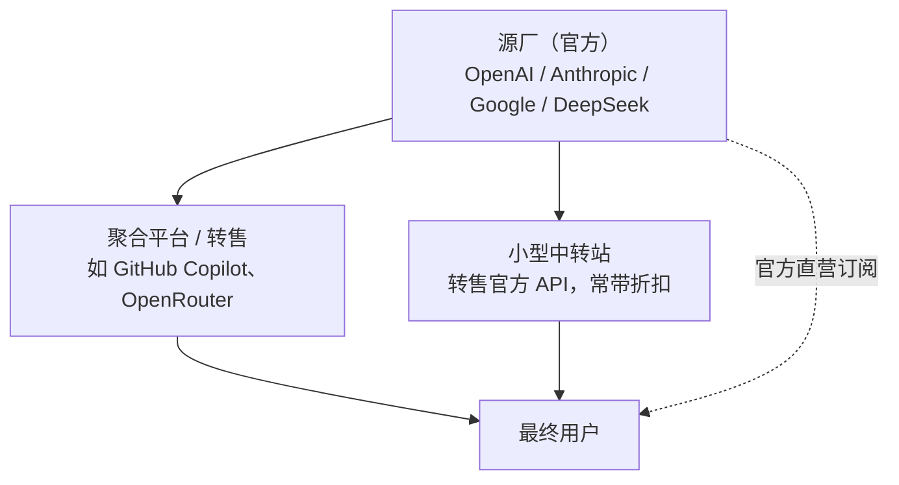

---
tags:
  - tutorial
  - ai
  - subscription
  - pricing
---

# AI 订阅与计费模式基础

## 学习目标

- 理解 AI 服务的两种主要购买方式：**套餐订阅**与 **API 按量计费**，以及两者的混合形态。
- 掌握阅读任何"AI 套餐"所需的术语：token、额度、限额、窗口、倍率。
- 认清 AI 服务的供应链结构（源厂 / 聚合平台 / 小型中转站），理解"为什么同一模型有不同价格"。
- 学会用"官方单价 × 自己的用量"粗算成本，判断某个套餐是否划算。

## 前置条件

- 已完成 [section1](../section1/) 环境安装。
- 具备浏览器使用能力，能接收手机短信验证码（本章会涉及账号与支付）。
- 不需要任何编程基础。

## 为什么把"订阅与计费"放在最前面

很多人以为使用 AI 工具的门槛是"会不会写 prompt"。实际卡住新手的三道门槛依次是：

| 门槛 | 典型问题                         | 对应内容                                                    |
| :--- | :------------------------------- | :---------------------------------------------------------- |
| 账号 | "GPT 用谷歌登录是什么意思？"     | [01_账号注册与2fa配置](01_账号注册与2fa配置.md)             |
| 支付 | "没有海外信用卡怎么订阅？"       | [02_支付渠道与订阅下单](02_支付渠道与订阅下单.md)           |
| 选购 | "官方、聚合、中转站到底买哪个？" | [03_平台选购_官方聚合与中转](03_平台选购_官方聚合与中转.md) |

这三件事做完，后面的 [section11](../section11/)（Copilot）、[section13](../section13/)（Claude Code / Codex）才谈得上"配置好就能用"。

> [!tip] 本节不推荐任何具体商家
> 本节只讲**判断方法**。所有价格、额度、平台名称都会随时间变化，文中出现的具体数字都标注了日期，务必以官方页面当期说明为准。

## 类比：AI 计费 ≈ 手机流量套餐

理解 AI 计费最快的方式，是把它类比成运营商的流量套餐：

| 类比项       | 手机流量                     | AI 服务                                                      |
| :----------- | :--------------------------- | :----------------------------------------------------------- |
| **套餐制**   | 月租 39 元含 100G 流量       | 月付 \$20，含"一定量的消息数 / 额度"                         |
| **按量计费** | 不办套餐，3 元 / G           | 不买订阅，API 按 token 计费                                  |
| **混合形态** | 超出套餐的部分按量计费       | 订阅额度用完后降速、限制模型，或转按量                       |
| **计费变体** | 定向流量、夜间流量、达量降速 | 峰谷计价、5 小时滚动窗口、周上限、输入 / 输出 / 缓存分别计价 |

记住这个类比，后面几乎所有"看不懂的额度规则"都能对上号：

- "5 小时窗口" ≈ 流量的"达量降速，下个时段恢复"。
- "周上限" ≈ 套餐的"月封顶"。
- "输入 / 输出分别计价" ≈ 打电话的"本地 / 长途"不同资费。

## 核心术语

| 术语                   | 说明                                                                                   |
| :--------------------- | :------------------------------------------------------------------------------------- |
| **token**              | 模型处理文本的最小计量单位。中文约 1 个字 ≈ 1 个 token，英文约 4 个字符 ≈ 1 个 token   |
| **额度 / 信用额度**    | 一个账户（或套餐）可以消耗的总量。官方订阅用"消息数 / 限额"表示，API 用"美元余额"表示  |
| **限额（rate limit）** | 单位时间内的最大消耗速度，例如"每 3 小时 N 条消息""每分钟 N 次请求"                    |
| **窗口**               | 限额的统计周期，常见"5 小时滚动窗口"（从发出第一条消息起算，滚动重置）                 |
| **倍率**               | 聚合平台常用：不同模型消耗额度的系数不同，例如某模型按 1.5 倍扣费                      |
| **缓存命中**           | 重复的上下文可被缓存，缓存读取（cache read）的单价通常远低于重新输入，直接影响实际花费 |

> [!warning] "额度"的数字不能直接横向比较
> 不同平台的额度单位五花八门：有的直接标美元（\$60 额度）、有的标点数（7500 点）、有的标消息数（160 条 / 3 小时）。比较前必须先统一成**同一口径**——推荐统一换算成"按官方 API 单价计算的花费"。

## AI 服务的供应链：源厂、聚合、中转

你在市面上能买到的 AI 服务，按"离源头的远近"分三层：

| 层级           | 是什么                                                  | 典型例子                                                 | 特点                               |
| :------------- | :------------------------------------------------------ | :------------------------------------------------------- | :--------------------------------- |
| **源厂**       | 训练并提供模型的公司，唯一"真货"来源                    | OpenAI、Anthropic、Google、DeepSeek                      | 价格最贵、最稳定、有官方保障       |
| **聚合平台**   | 各家源厂的模型 / API 的零售、转售商，通常有正规运营主体 | GitHub Copilot（大型聚合）、OpenRouter、各类"套餐型"平台 | 有额度折扣、支付友好、需核实其信誉 |
| **小型中转站** | 个人或小团队转售 API 的中介                             | 大量不知名站点                                           | 价格最低、不确定性最高、风险自担   |

**关键结论**：买任何第三方服务，本质是"用价格折扣换确定性"。折扣越大，你承担的不确定性（跑路、降智、隐私、合规）通常也越高。

> [!note] 规模不同，层级相同
> GitHub Copilot 自己也归在聚合层：它不训练前沿大模型，套餐里跑的是 OpenAI / Anthropic / Google 等源厂的模型，只是运营主体正规、信誉接近官方。小型中转站与它处在同一链条位置，区别只在风险等级——所以判断时看的不是"叫什么名字"，而是"模型从哪来、主体是谁、凭据要不要"。

## 价格差从哪来

同样标称"GPT / Claude 模型"，第三方为什么能比官方便宜？常见来源按风险从低到高排列：

| 来源                         | 说明                                                                                 | 风险                            |
| :--------------------------- | :----------------------------------------------------------------------------------- | :------------------------------ |
| 区域定价差                   | 不同国家的订阅价格、税率不同（见 [02](02_支付渠道与订阅下单.md)）                    | 低                              |
| 批量采购 / 企业折扣          | 平台与源厂签量级协议后零售                                                           | 低                              |
| 套餐价与 API 价的折算差      | 套餐"用满"的 API 等价价值远高于月费；把套餐额度**按 API 单价折算**零售，即"倍率折扣" | 中：订阅账号转 API 违反平台条款 |
| 共享账号 / 拆座位            | 多人共用一个账号或一个企业席位                                                       | 中：聊天记录互相暴露            |
| 账号黑产（盗刷、黑卡、盗号） | 支付来源本身是欺诈                                                                   | 高：随时掉权益，甚至牵连责任    |

> [!note] "倍率折扣"最常见的一种做法
> 很多第三方（尤其转售 GPT 类模型的平台）是这样定价的：**进货**用官方订阅套餐，**出货**却按官方 API 单价折算成"额度"。若一份 \$20 / 月的订阅跑满，按 API 单价折算可能价值 \$100+，平台把差额的一部分让给用户，就形成 5–7 倍的额度倍率。这解释了倍率为什么能远高于 1，也解释了平台为什么随时调价、限速、换模型——它自己也要受那份套餐的额度与限速约束。

> [!danger] 判断红线
> 如果一个第三方价格**显著低于**"官方套餐用满的 API 等价价值"，大概率已经进入后两档。不要用"我只是买家"来说服自己——权益被清算时，损失由买家先承担。

## 粗算成本：判断套餐是否划算

不需要精确统计，用一个估算流程即可：

1. **查官方单价**：在源厂定价页找到"输入 / 百万 token""输出 / 百万 token"的单价。
2. **估自己的用量**：一次对话大约消耗多少 token（可以看官方用量页面或工具内的 token 统计）。
3. **算等价花费**：用官方单价算出这些用量"按量付费"要多少钱。
4. **对比月费**：等价花费 ÷ 月费 = 套餐的"倍率"；倍率越高，套餐越划算（前提是你能用满）。

> [!example] 举例（数字仅为演示）
> 假设某模型输入 \$1 / 百万 token、输出 \$6 / 百万 token。你每天用 Agent 处理约 200 万输入 + 20 万输出 token，一个月按 22 天工作日算：
>
> - 输入：200 万 × 22 × \$1 / 百万 = **\$44**
> - 输出：20 万 × 22 × \$6 / 百万 = **\$26.4**
> - 合计约 **\$70.4 / 月**
>
> 若某 \$10 / 月套餐能给到同等用量的访问权，则倍率约 7 倍，明显划算；反过来，若你只是偶尔聊天，等价花费可能只有 \$2–3，此时任何 \$20 / 月的订阅都是浪费。

## 消费策略

1. **从小到大**：任何平台第一次购买都选最低档、最短周期；认为不靠谱就不要年付。
2. **先评估、再升级**：用一个月统计自己的真实用量，再决定是否升档。额度"用不满"就是浪费。
3. **关注调价历史**：平台大幅削减额度、下架模型、调整倍率都是常态，买前先看它的历史公告。
4. **把不确定性计入成本**：中转站"便宜"到离谱时，你省下的钱本质是风险溢价。
5. **核心工作流留在源头**：涉及隐私数据、长期依赖的工作，尽量使用官方或可信聚合平台。

## 常见问题

### Q：我只是想聊天，需要懂这么多吗？

如果只用免费版或单一官方订阅（如 ChatGPT Plus），可以粗略了解即可。但只要涉及"哪个平台更便宜""要不要买中转站"，本节和后续 [03_平台选购](03_平台选购_官方聚合与中转.md) 的判断框架就必要了。

### Q：套餐里的"额度"用不完可以留到下个月吗？

一般不能。绝大多数套餐额度按月（或按窗口）清零，少数平台提供"额度结转"活动，属于特例。

### Q：为什么同一平台不同模型价格差好几倍？

模型越大、越新，单 token 成本越高。平台通常对不同模型设置不同倍率，选购时要看"你需要的那几个模型"的倍率，而不是只看总额度。

## 练习任务

1. 打开任意一家官方定价页，找出两个模型"输入 / 输出"的每百万 token 单价，并计算比值。
2. 用上面的估算流程，粗算自己"如果每天重度使用 Agent 一个月"的 API 等价花费。
3. 列出你听说过的三个第三方 AI 服务平台，分别判断它们属于"聚合平台"还是"小型中转站"，并写出判断依据。

## 验收清单

- [ ] 能用自己的话说清"套餐订阅"与"API 按量计费"的区别，以及与手机流量套餐的类比。
- [ ] 能解释 token、额度、限额、窗口、倍率五个术语。
- [ ] 能画出源厂 → 聚合 → 中转 → 用户的供应链关系图。
- [ ] 能说出至少三种"第三方为什么能便宜"的原因，并指出其中风险最高的两种。
- [ ] 会用自己的用量粗算某个套餐是否划算。
