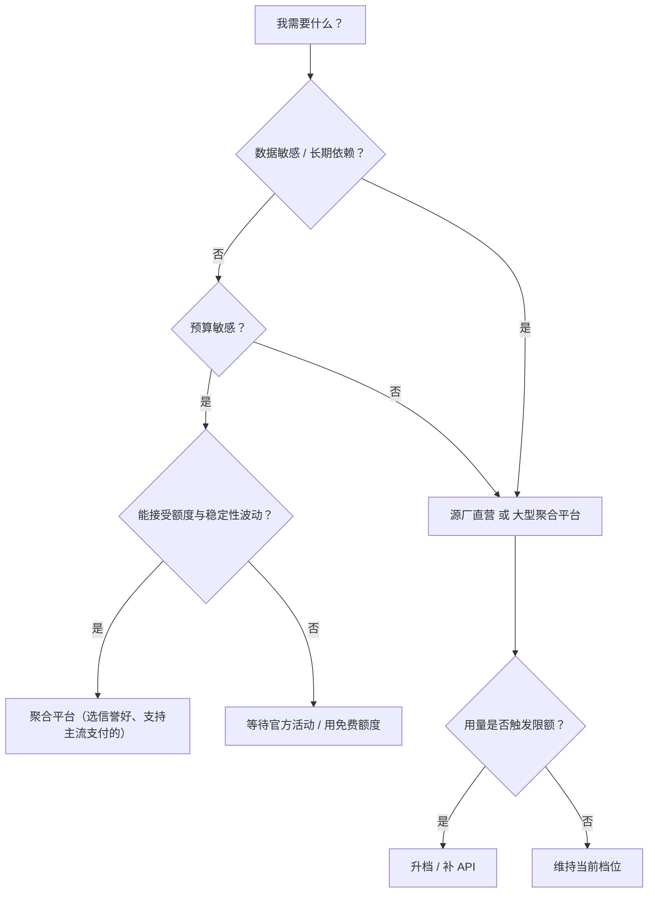

---
tags:
  - tutorial
  - ai
  - subscription
  - platform
---

# 平台选购：官方、聚合与中转

## 学习目标

- 分清"源厂直营 / 聚合平台 / 小型中转站 / API 直连"四类供给，各自的定位与适用人群。
- 掌握评估一个聚合平台的六个维度（额度、信誉、支付、模型、费用、接入）。
- 学会识别中转站的低价陷阱，用"模型一致性测试"验证真假。
- 完成一次自己的选型决策，并知道什么时候该升级、什么时候该换平台。

## 前置条件

- 已读完 [00_AI 订阅与计费模式](00_ai订阅与计费模式.md)，理解额度、倍率、token 等术语。
- 已按 [01_账号注册与2fa配置](01_账号注册与2fa配置.md) 与 [02_支付渠道与订阅下单](02_支付渠道与订阅下单.md) 准备好账号与支付能力。

## 四类供给对比

| 类型           | 是什么                              | 典型代表                                                                                                             | 优势                               | 代价                               |
| :------------- | :---------------------------------- | :------------------------------------------------------------------------------------------------------------------- | :--------------------------------- | :--------------------------------- |
| **源厂直营**   | 源厂直接卖给终端用户的订阅套餐      | [ChatGPT / Claude](../section13/00_多模型agent总览与订阅说明.md)、Gemini 等                                          | 最稳定、有官方支持、隐私有保障     | 单价最高、支付门槛高               |
| **聚合平台**   | 把各家源厂的模型 / API 重新打包零售 | [GitHub Copilot](../section11/00_copilot基础与订阅说明.md)（大型聚合）、OpenCode Go、CommandCode GOAT、OpenRouter 等 | 额度折扣大、支付方式友好、可多模型 | 需核实信誉、额度规则可能单方面调整 |
| **小型中转站** | 个人 / 小团队转售 API 的中介        | 大量不知名站点                                                                                                       | 门槛最低、价格最低                 | 稳定性与隐私风险最高               |
| **API 直连**   | 直接购买源厂 API Key                | OpenAI / Anthropic / DeepSeek 开放平台                                                                               | 最灵活、可自动化、无中间商         | 按量付费、需要自己搭客户端         |

> [!note] 为什么 Copilot 归在"聚合平台"？
> GitHub Copilot 自己不训练前沿大模型，套餐里跑的是 OpenAI / Anthropic / Google 等源厂的模型（外加少量自研小模型），从供应链看属于**大型聚合 / 转售**，只是运营主体正规、信誉接近官方。选购时可以把它当"准官方"选项——但要记得：额度规则由 GitHub 决定，而不是模型厂商。

## 订阅怎么选：源厂直营 vs 大型聚合

订阅类的选购原则很简单：**按用量强度和"用不用得上高级模型"选档**。

- 各家的价格表、档位差异，本教程已经整理齐全，**不要凭印象买**：
  - Claude / ChatGPT（Codex）：**源厂直营**订阅，见 [section13/00](../section13/00_多模型agent总览与订阅说明.md)。
  - GitHub Copilot：**大型聚合**订阅（转售多家源厂模型），见 [section11/00](../section11/00_copilot基础与订阅说明.md)。
- 通用判断方法：
  1. 先用最低档（或免费版）跑 2–4 周。
  2. 记录"是否触发限额""是否被降级到小模型""是否经常等窗口重置"。
  3. 有 2 项以上经常发生，再考虑升档；否则维持或降档。

> [!tip] 正规订阅的隐藏好处
> 无论是源厂直营还是大型聚合（如 Copilot），正规订阅通常自带**账号级风控保护、发票/账单、客服申诉渠道**。这些在你使用强度高之后会变得重要，小型第三方平台大多无法提供。

## 聚合平台：把"额度"当商品卖

聚合平台的模式是：以批发价（或转售权）拿到**源厂资源**，再以"小份套餐"零售——你付 \$10，可能拿到"按源厂 API 单价计算价值 \$60–\$70 的用量"。**额度倍率**因此成为最直观的比较指标：

$$
\text{额度倍率} = \frac{\text{套餐内的 API 等价额度}}{\text{套餐价格}}
$$

倍率越高，理论性价比越高；但倍率是**平台可以单方面修改的**，这正是聚合平台最大的不确定性。

### 倍率从哪来：套餐价 vs API 价

倍率不是平台凭空让利，最常见的做法是**"进货用套餐，出货按 API 价折算"**：

- 官方订阅套餐"跑满"的 API 等价价值远高于月费（一份 \$20 / 月的订阅跑满，按 API 单价折算可能价值上百美元）；
- 平台把这部分用量**按 API 单价折算成"额度"**零售，套餐成本与额度标价之间的差，就是 5–7 倍甚至更高的"倍率折扣"。

知道这一点，可以推出两个判断：

1. **倍率越高，越要问"进货方式"**：正规企业采购的折扣有上限；明显超高的倍率往往对应灰色来源（订阅账号转 API、地区套利、共享账号），随时可能被源厂收紧或清退。
2. **平台的额度与限速，受它自己那份套餐约束**：源厂调整套餐规则、限速或下架模型时，平台会同步调价、降倍率或换模型——这是"额度会变"的根本原因。

### 评估聚合平台的六个维度

| 维度           | 检查什么                                                    | 危险信号                                     |
| :------------- | :---------------------------------------------------------- | :------------------------------------------- |
| **额度与倍率** | 总额度、各模型倍率、是否区分输入/输出（缓存）计费           | 只宣传总倍率，细则里对高级模型设极高倍率     |
| **调价信誉**   | 历史上是否大幅削减过额度、下架过模型、变更过计费规则        | "宣传时说 8 倍，三个月后变 2 倍"             |
| **支付方式**   | 是否支持支付宝 / 微信 / 银联；是否有手续费                  | 只收加密货币 / 无任何正规收款渠道            |
| **模型覆盖**   | 是否提供你真正需要的高级模型（GPT / Claude 系）             | 只有开源模型，却按"高级模型"宣传             |
| **费用透明度** | 标价之外是否有手续费、汇率加价                              | 结账金额明显高于宣传价                       |
| **接入兼容性** | 是否提供 OpenAI / Anthropic 兼容接口，能否接入 VS Code 插件 | 只能用其自制客户端，无法接入 Copilot / Codex |

### 案例：OpenCode Go 与 CommandCode GOAT（2026-10 快照）

两个常被拿来比较的 \$10 档聚合套餐（信息来自社区讨论与官方页面，**随时可能变化，仅作方法示例**）：

| 对比项       | OpenCode Go                                                                            | CommandCode GOAT                             |
| :----------- | :------------------------------------------------------------------------------------- | :------------------------------------------- |
| 价格         | 约 \$10/月（另有更低档位时有时无）                                                     | 约 \$10/月，但**结账含手续费，实际高于标价** |
| 额度         | 约 \$60 等价额度（2026-08 观察，约 6 倍）                                              | 约 \$70 等价额度（2026-08 观察，约 7 倍）    |
| 模型覆盖     | 以开源 / 国产模型为主（DeepSeek、Qwen、Kimi 等）                                       | 覆盖更多高级模型（含 GPT / Claude 系）       |
| 支付         | 支持支付宝                                                                             | 支持支付宝                                   |
| 额度稳定性   | 有**大幅削减额度**的历史（如 DeepSeek Flash 档从 \$120 一路调整为 \$15 → \$30 → \$60） | 相对稳定                                     |
| 邀请机制     | 有邀请码机制（**仅订阅期间可生成**，可抵额度）                                         | 未见公开的邀请码 / 推荐入口（2026-10 核对）  |
| 接入 VS Code | 提供兼容接口，可接入 Copilot 等客户端                                                  | 同左                                         |

**社区共识（截至 2026-10，仅代表当时的判断）**：

- 一般情形更推荐 **CommandCode GOAT**：额度更高、调价历史更稳、支持支付宝、高级模型更多。
- 只有同时满足"**只用 DeepSeek 系模型 + 额度预期稳定 + 手上已有邀请码**"时，OpenCode Go 才是更优选择。
- 两家都提供兼容接口，可参考 [section11/01](../section11/01_扩展接入自定义api.md) 接入 VS Code。

> [!warning] 不要把"案例表"当购买指南
> 聚合套餐的额度与价格变动极快（上表的数字来自 2026-08–10 的公开信息）。购买前**必须**重新查看官方当期说明，并按上面六维度逐项核对。

## 小型中转站：便宜背后的账

### 中转站的商业模式

源厂的官方 API 是**按 token 原价计费**的，价格不低。中转站能以明显低于官方的价格转售，通常来自以下几种成本来源（风险递增）：

1. 批量采购折扣、企业额度。→ 低风险。
2. 用低价区 / 活动价账号（含"**订阅套餐按 API 价折算**"）的额度转租。→ 违反平台规则，随时失效。
3. 用盗刷、黑卡、被盗账号的额度。→ 你的使用可能牵连进风控链条。
4. 以低配模型冒充高级模型（俗称"降智"）。→ 你付了钱但拿不到承诺的能力。
5. 留存你的请求与响应数据，转卖或用于训练。→ 隐私泄露。

### 判断中转站是否可信

- **能否验证模型真伪**：用同一 prompt 在官方与中转站各跑一次，对比回答风格、知识边界、token 计费是否一致；高级模型可要求其返回模型自述（仅供参考，易被伪造）。
- **是否要求异常凭据**：任何索要你的**官方账号密码、Session Token、API Key** 的中转站都要立刻放弃。
- **是否有可追溯的主体**：公开的公司信息、发票、客服渠道、稳定的域名与社区口碑。
- **是否解释计费规则**：清晰列出各模型单价 / 倍率、缓存计费、上下文加价等。
- **小额先行**：任何平台的第一次购买都选最低档；跑满一个周期再决定是否续费。

## 选型决策流程

## 消费常识（新手最容易踩的坑）

1. **不要一上来买最贵的档**：先用最低档评估，再逐步加码。
2. **不要年付试水**：第一次购买任何陌生平台都选月付。
3. **把"额度会变"当作常态**：任何第三方额度规则都可以单方面调整，重要工作流要有源厂直营（或 API 直连）的备份通道。
4. **隐私数据不上第三方**：代码、客户资料、内部文档，尽量走源厂直营渠道。
5. **警惕"永久额度""一次买断"**：AI 服务成本按月结算，永久承诺违背商业逻辑。

## 常见问题

### Q：聚合平台和源厂直营订阅，能同时买吗？

可以，也很常见：源厂直营订阅负责日常交互，聚合套餐负责大额度批量任务，两者互补。但要注意同一账号不要在有冲突的设备/地区登录，以免触发风控。

### Q：为什么有的聚合平台只卖开源模型，有的能卖 GPT / Claude？

能否售卖高级模型取决于平台与源厂的合作（或转售）关系。覆盖高级模型的平台通常成本更高、倍率更低，这是正常的市场结构。

### Q：中转站"降智"怎么验证？

最可靠的方法是**同一 prompt 双跑对比**（官方 vs 中转），观察回答质量、风格与 token 计费是否一致；辅助方法包括核对模型自述、检查响应延迟与上下文长度限制是否符合官方规格。

### Q：用了第三方平台，账号会被源厂封吗？

有可能。使用非源厂渠道获取服务可能违反平台条款；风控通常按"账号 + 支付 + 登录环境"整条链判断，个体很难申诉。

## 练习任务

1. 任选两个聚合平台，按"六个维度"填一张评估表，给出你的选择与理由。
2. 去其中一个平台的官方页面，找出它**当前**的额度、倍率与调价公告，与本文案例表对比，记录变化。
3. 写一段 100 字左右的"我为什么选择这条购买路径"的说明，包含成本、风险与替代方案。
4. 列出你工作流中**绝对不能上第三方**的两类数据，并说明为什么。

## 验收清单

- [ ] 能说出四类供给各自的定位，并解释聚合平台"倍率"是什么。
- [ ] 能用六个维度评估一个聚合平台，并识别至少三个危险信号。
- [ ] 能说清中转站低价可能的五种来源，以及各自风险。
- [ ] 知道如何用"双跑对比"验证中转站是否降智。
- [ ] 已形成自己的选型结论：现在买什么、预算多少、什么条件上升级。
